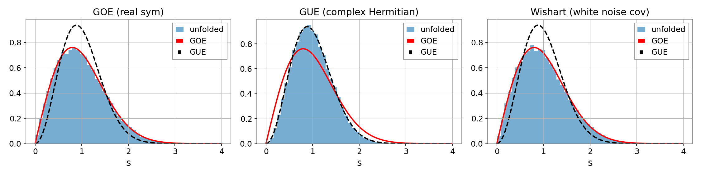
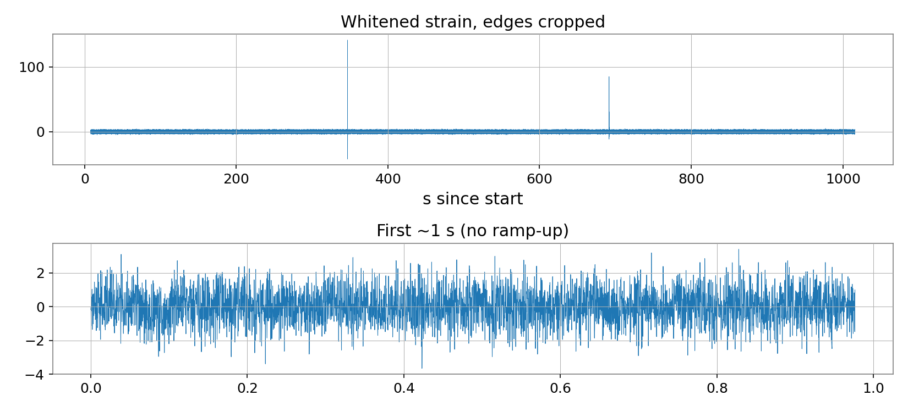
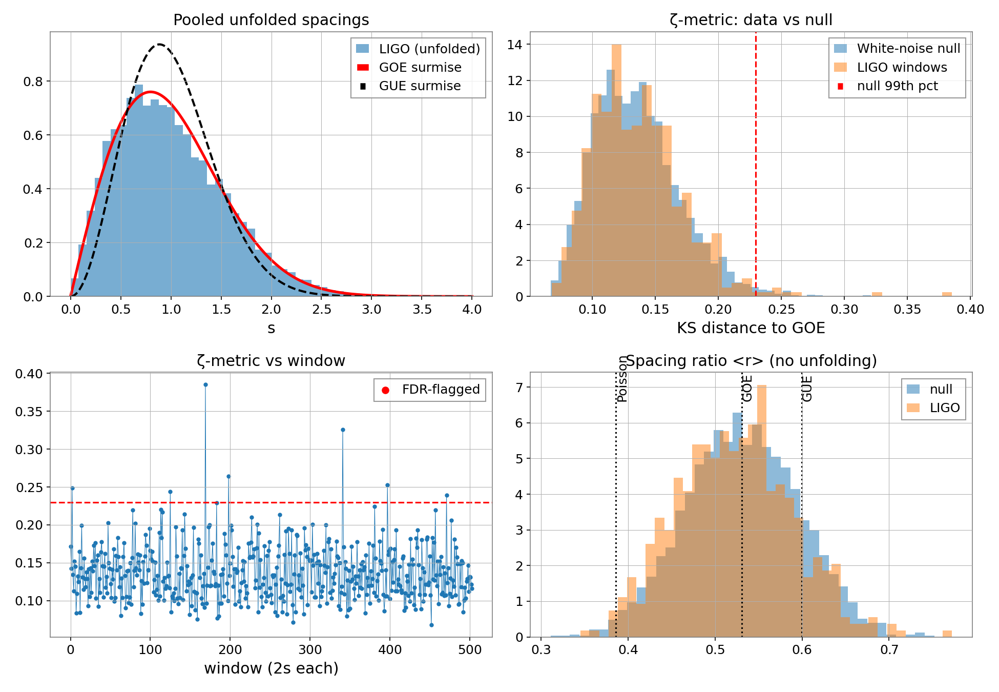
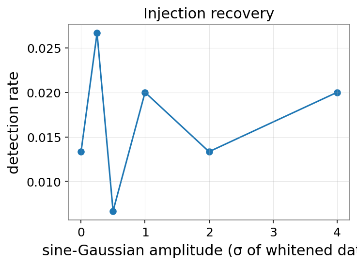
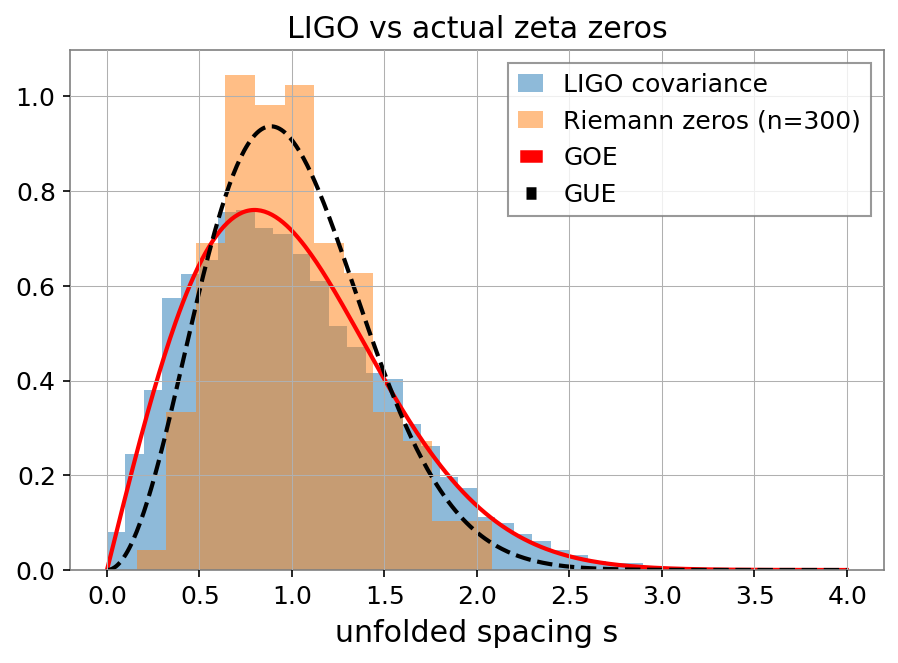

# Random Matrix Statistics of LIGO Noise (the "ζ-metric" project)

I wanted to see if the eigenvalue spacings of covariance matrices made from LIGO strain data follow the universal random matrix theory (RMT) statistics, and whether windows that *don't* follow them could point to weird noise (glitches etc.).

**Short version: they follow them. I didn't find any anomalous windows**, and my method turned out to be not very sensitive to injected signals. So this is basically a negative result with a pipeline I trust. I've tried to be honest about what worked and what didn't below.

---

## What I did

1. Downloaded 1024 s of H1 strain from GWOSC (O3, GPS start 1238166018), whitened it, and cut 8 s off each end because the whitening filter makes a ramp-up at the edges (my first version had this problem).
2. Split the data into 504 non-overlapping 2 s windows.
3. For each window I reshaped the samples into a matrix with p = 32 columns (n = 256 rows) and took the 32×32 covariance matrix. This is full rank, unlike my first attempt.
4. **Unfolded** the eigenvalues (fit a polynomial to the cumulative eigenvalue count, trimmed 10% at each edge) so the average spacing is 1.
5. Defined the **ζ-metric** as the KS distance between a window's unfolded spacings and the GOE Wigner surmise.
6. Also computed the spacing ratio ⟨r⟩, which doesn't need unfolding, as a cross-check.
7. Built a **null** from 3000 white-Gaussian-noise windows run through the exact same pipeline, got empirical p-values, and used Benjamini–Hochberg FDR to decide what counts as flagged.
8. Injected fake bursts to see if the method can actually detect anything.
9. Compared with the spacing distribution of the first 300 actual Riemann zeta zeros.

## Things I got wrong at first (and fixed)

My first notebook had a bunch of problems that I only caught after getting feedback, so I'm listing them here:

- **Wrong ensemble.** A covariance matrix of real data is real symmetric, so it should follow GOE (orthogonal), not GUE (unitary). I'd been comparing against GUE.
- **No unfolding.** I only divided by the mean spacing, but the eigenvalue density of a covariance matrix isn't flat, so spacings went out to ~35 and the KS distance was 0.99. That was an artifact, not noise structure.
- **Degenerate matrix.** My second notebook built a 1023×1023 covariance matrix from 256 samples, so it was rank deficient.
- **Fake "anomalies".** I flagged windows above the 80th percentile, which always flags 20% of windows by definition. That's not detection. Now I use a Monte Carlo null and FDR.
- **Edge transient** in the whitened data (see above).

## Results

### Does the pipeline work? (`fig1_sanity.png`)

I ran synthetic matrices of the same size (32×32) through the same pipeline:

| Ensemble | KS vs GOE | KS vs GUE | ⟨r⟩ | theory ⟨r⟩ |
|---|---|---|---|---|
| GOE (real symmetric) | 0.0040 | 0.0716 | 0.5314 | 0.531 |
| GUE (complex Hermitian) | 0.0697 | 0.0025 | 0.5995 | 0.600 |
| Wishart (white noise covariance) | 0.0035 | 0.0705 | 0.5310 | 0.531 |

So it can tell GOE and GUE apart, and white-noise covariance matrices behave like GOE, which is what theory says. (The tiny non-zero KS for GOE is because the Wigner surmise is only an approximation of the exact GOE spacing.)



### The data (`fig2_whitened.png`)

The ramp-up is gone after cropping. There are two big glitches in this stretch, around 346 s and 690 s from the start.



### LIGO vs the null (`fig3_main.png`)

| | |
|---|---|
| windows | 504 (2 s each) |
| mean ζ-metric | 0.137 |
| mean ⟨r⟩ | 0.523 (GOE = 0.531, GUE = 0.600, Poisson = 0.386) |
| windows with p < 0.05 | 25 / 504 (5.0%, and you'd expect ~25 by chance) |
| windows with p < 0.01 | 7 / 504 (~5 expected by chance) |
| flagged after FDR (q < 0.05) | **0** |
| smallest q-value | 0.084 |

The LIGO ζ-metric histogram lies basically on top of the white-noise null, so I can't say these windows are different from Gaussian noise.



One interesting thing: the two highest-ranked windows (index 169 and 341, GPS 1238166364 and 1238166708) line up in time with the two huge glitches in the whitened strain plot. But neither passes FDR (q = 0.084 for both), so I'm only calling this suggestive. I still need to check them against GWOSC data quality flags / Gravity Spy.

### Injection test (`fig4_injection.png`)

I injected a sine-Gaussian burst (150 Hz) into random real windows, 150 trials per amplitude, using the null's 99th percentile as the threshold (so about 1% false positive rate):

| amplitude (σ of whitened data) | detection rate |
|---|---|
| 0 | 1.3% |
| 0.25 | 2.7% |
| 0.5 | 0.7% |
| 1 | 2.0% |
| 2 | 1.3% |
| 4 | 2.0% |

The detection rate never goes above the false positive level, so **the ζ-metric can't see bursts like this up to 4σ.** I think that's because a short burst only changes the covariance matrix by a small amount, but I haven't tested that properly. The two huge glitches (~100σ in the plot) are much louder than anything I injected, so the method might only pick up really loud stuff.



### Riemann zeta zeros (`fig5_zeta.png`)

The original idea was to compare against the spacing distribution of the Riemann zeta zeros. I unfolded the first 300 zeros (using the smooth zero counting function) and compared their spacing histogram with the pooled LIGO one:

| | KS vs GUE | KS vs GOE | KS vs zeros |
|---|---|---|---|
| Zeta zeros (n = 300) | 0.0616 | 0.1286 | n/a |
| LIGO windows (pooled) | 0.0788 | 0.0163 | 0.1396 |

The zeros sit on GUE (Montgomery–Odlyzko) and LIGO sits much closer to GOE, so the zeta zero spacings are not a good description of this data. That makes sense: real covariance matrices are in the orthogonal class and zeta zeros are in the unitary class.

One thing I noticed: the pooled LIGO KS vs GOE (0.0163) is bigger than what I got for synthetic GOE/Wishart matrices (~0.004), and mean ⟨r⟩ is 0.523 instead of 0.531. So there might be a small real deviation from GOE in the pooled data. But the per-window test found nothing significant, so I'm not claiming anything. To check this properly I need the pooled KS of the white-noise null for a fair comparison (todo).



## What I conclude

- The pipeline works on synthetic data.
- This stretch of H1 noise looks like white Gaussian noise as far as these spacing statistics go. I did **not** find non-universal behaviour.
- The ζ-metric as I defined it isn't sensitive to the bursts I injected, so a clean result here doesn't prove the noise is perfectly stationary either.
- This isn't a new discovery, and I'm not claiming any link between LIGO noise and the zeta function. (RMT on covariance spectra is a well-known technique.) It's a learning project where I built the whole thing properly and tested it.

## Limitations

- One detector (H1), one 1008 s stretch.
- Haven't cross-checked windows with GWOSC data quality flags or Gravity Spy.
- The null is white Gaussian noise. Real whitened noise isn't perfectly white or Gaussian, so a null from quiet real data would be a harder test.
- Only one burst shape and amplitudes up to 4σ in the injection test.
- I normalised the whitened data by its overall std, which includes the two glitches.
- "ζ-metric" is just my name for the KS distance to GOE. It doesn't actually use the zeta function.

## Files

```
README.md
zeta_metric_ligo.ipynb      # Colab notebook, Cells 1-10
zeta_metric_windows.csv     # per-window zeta, <r>, p-value, q-value, flag
injection_recovery.csv
fig1_sanity.png
fig2_whitened.png
fig3_main.png
fig4_injection.png
fig5_zeta.png
```

## Running it

Open the notebook in Colab and run the cells in order. Needs `numpy`, `scipy`, `pandas`, `matplotlib`, `gwpy`, `gwosc`, `scikit-learn`, `mpmath`. Seed is fixed (`SEED = 42`). Data downloads automatically from GWOSC. (If Colab complains about `cryptography` / `igwn-auth` versions it's harmless for open data.)

## Things I want to try next

- Compute the pooled KS of the white-noise null and compare with LIGO's 0.0163.
- Check the high-ζ windows against GWOSC DQ flags and Gravity Spy.
- Inject much louder bursts (10-100σ) to find where the method starts working.
- Build the null from quiet real data instead of white noise.
- Try L1 and other observing runs.
- Compare against a simple baseline like rolling variance to see if spacing statistics even add anything.

## References

- Mehta, *Random Matrices*
- Oganesyan & Huse (2007); Atas et al., PRL 110, 084101 (2013) for the spacing ratio
- Montgomery (1973); Odlyzko (1987) for zeta zeros and GUE
- Data: GWOSC, https://gwosc.org
